# Lab9Web — Praktikum 9: PHP Modular

* **Nama**: Guntur Cahyadewangga
* **NIM**: 312510265
* **Kelas**: I251C
* **Mata Kuliah**: Pemrograman Web

Repository ini berisi hasil pengerjaan **Praktikum 9: PHP Modular** pada mata kuliah Pemrograman Web. Fokus praktikum mencakup modularisasi program, perbedaan pemanggilan file (`include`, `require`, `include_once`, `require_once`), penggunaan template bersama, pembuatan dan penggunaan `function` serta file *helper*, struktur direktori modular, *routing* berbasis parameter URL dengan *whitelist*, dan integrasi dengan aplikasi CRUD database.

---

## Tujuan Project
1. Memahami konsep, tujuan, dan manfaat modularisasi pada aplikasi PHP.
2. Membedakan perilaku `include`, `require`, `include_once`, dan `require_once` (terutama saat file tidak ditemukan atau dimuat berulang).
3. Menyusun template layout bersama (`header` dan `footer`) agar tidak terjadi duplikasi kode antarmuka pada tiap halaman.
4. Membuat dan menggunakan `function` berparameter dan bernilai *return*, serta menyimpannya ke dalam file *helper*.
5. Menata struktur direktori aplikasi PHP secara modular sesuai tanggung jawab masing-masing folder/file.
6. Menerapkan *routing* sederhana melalui `index.php` dengan parameter `page`, validasi *whitelist*, dan penanganan halaman `404`.
7. Mengintegrasikan modularisasi dan *routing* ke dalam aplikasi CRUD database dari praktikum sebelumnya.

---

## Kebutuhan Perangkat
* **Web Server & PHP**: Apache (melalui XAMPP / Laragon) dan PHP.
* **Database**: MySQL / MariaDB (untuk fitur CRUD).
* **Browser**: Web browser modern (Google Chrome / Microsoft Edge).
* **Code Editor & Version Control**: Visual Studio Code dan Git.

---

## Cara Menjalankan Aplikasi
1. Clone atau salin folder project ke direktori *document root* web server lokal (contoh di XAMPP: `C:\xampp\htdocs\`).
2. Jalankan layanan **Apache** (dan **MySQL** untuk modul CRUD database) melalui XAMPP Control Panel.
3. Sesuaikan konfigurasi koneksi database pada `config/database.php` (jika menggunakan modul CRUD).
4. Buka aplikasi melalui browser:
   * Latihan awal / multi-halaman: `http://localhost/lab9_php_modular/`.
   * Aplikasi modular & routing CRUD: `http://localhost/project/index.php`.

---

## Struktur Direktori

### 1. Folder Latihan Awal & Template (`lab9_php_modular/`)
```text
lab9_php_modular/
├── uji-include.php
├── pesan.php
├── header.php
├── footer.php
├── home.php
├── about.php
├── profil.php
├── kontak.php
└── style.css
```

### 2. Struktur Direktori Aplikasi Modular & Routing (`project/`)
```text
project/
├── index.php
├── config/
│   └── database.php
├── views/
│   ├── header.php
│   ├── footer.php
│   ├── dashboard.php
│   └── 404.php
├── helpers/
│   └── functions.php
├── modules/
│   ├── user/
│   │   ├── list.php
│   │   ├── add.php
│   │   ├── edit.php
│   │   └── delete.php
│   └── auth/
│       ├── login.php
│       └── logout.php
└── assets/
    ├── css/
    └── js/
```

**Tanggung jawab utama tiap bagian:**
* `index.php`: *Entry point* aplikasi dan *router* utama berdasarkan parameter URL.
* `config/`: Pengaturan konfigurasi aplikasi dan koneksi database.
* `views/`: Komponen tampilan bersama (`header.php`, `footer.php`), halaman `dashboard.php`, dan `404.php`.
* `helpers/`: Kumpulan `function` bantuan yang dapat dipakai ulang lintas modul.
* `modules/`: Modul fitur aplikasi yang dikelompokkan berdasarkan domain (misalnya `user/` dan `auth/`).
* `assets/`: Berkas statis seperti CSS, JavaScript, dan gambar.

---

## Daftar Rute Aplikasi
* `index.php` atau `index.php?page=dashboard` -> Memuat `views/dashboard.php`.
* `index.php?page=user/list` -> Memuat `modules/user/list.php` (daftar data pengguna).
* `index.php?page=user/add` -> Memuat `modules/user/add.php` (form tambah pengguna).
* `index.php?page=user/edit` -> Memuat `modules/user/edit.php` (ubah data pengguna).
* `index.php?page=user/delete` -> Memuat `modules/user/delete.php` (hapus data pengguna).
* Rute tidak terdaftar / tidak valid (misalnya `page=admin/rahasia`) -> Mengembalikan status HTTP `404` dan memuat `views/404.php`.

---

## Langkah Praktikum & Dokumentasi Screenshot

### 1. Pengujian `include` dan `require`
* Membuat file `pesan.php` dan `uji-include.php`, lalu menguji kondisi saat file yang dipanggil tidak ditemukan.
* Menggunakan `include` menghasilkan *warning* namun eksekusi baris setelah pemanggilan tetap berjalan.
* Menggunakan `require` menghasilkan *warning* sekaligus *fatal error* sehingga eksekusi program terhenti.

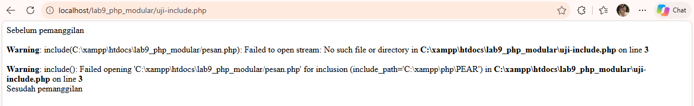
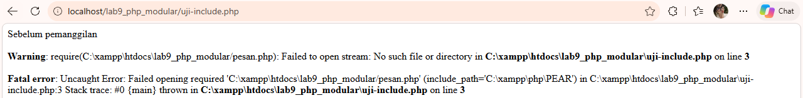

### 2. Template Layout Bersama & Function Helper
* Memisahkan bagian layout bersama ke `header.php` dan `footer.php` serta mengatur gaya tampilan pada `style.css`.
* Membuat `function` pada file *helper* (seperti konversi suhu Celcius ke Fahrenheit, penentuan predikat nilai, perhitungan total belanja, format rupiah, diskon, dan peringkasan teks) lalu mengujinya pada halaman aplikasi.

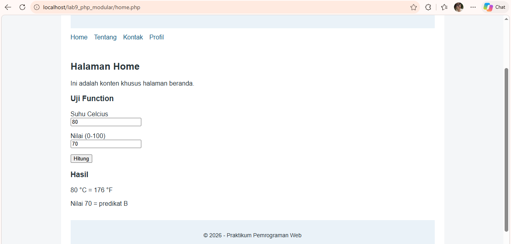
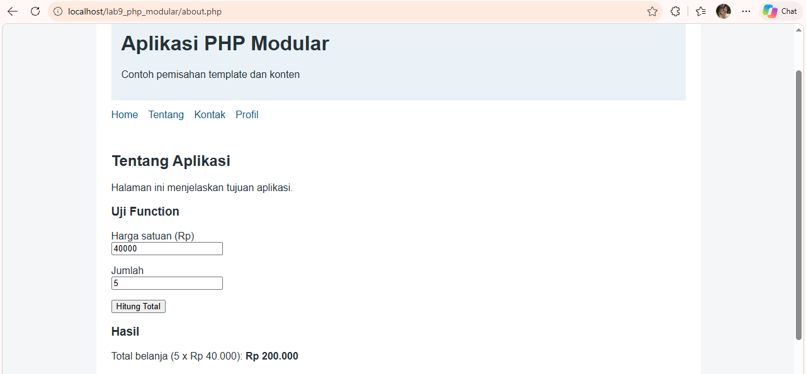
.PNG)
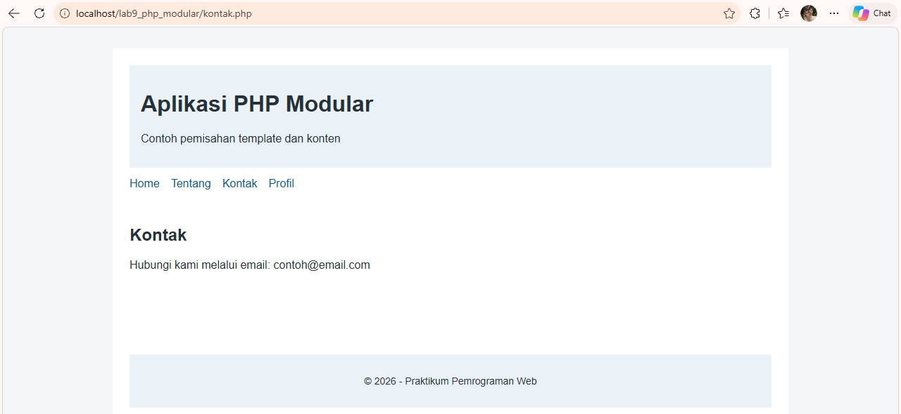

### 3. Struktur Direktori, Routing, & Pengujian CRUD
* Menyusun struktur direktori modular pada `project/` dan menerapkan *router* berbasis *whitelist* di `index.php`.
* Menguji navigasi *routing* (`page=dashboard`, `page=user/list`, `page=user/add`, `page=user/edit`) serta alur operasi CRUD pengguna (tambah data, ubah data, konfirmasi hapus, dan hapus data) beserta notifikasi status.

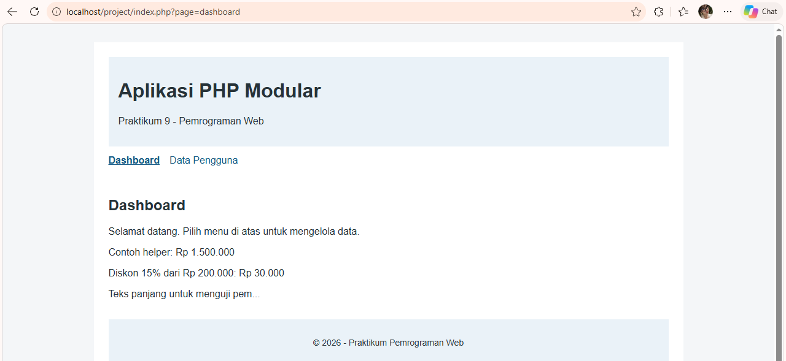
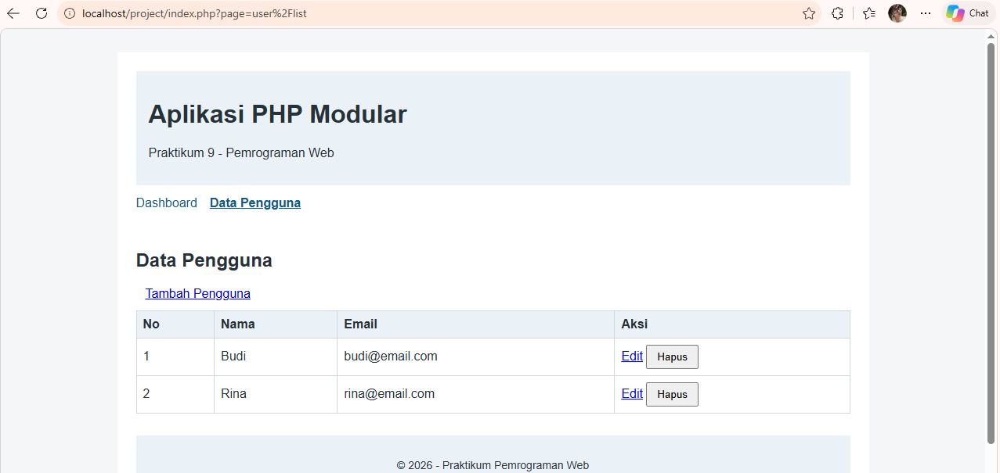
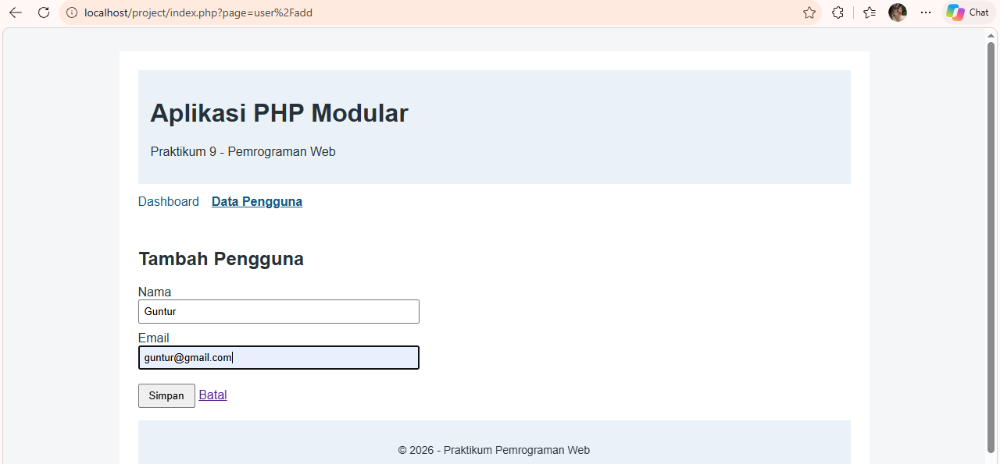
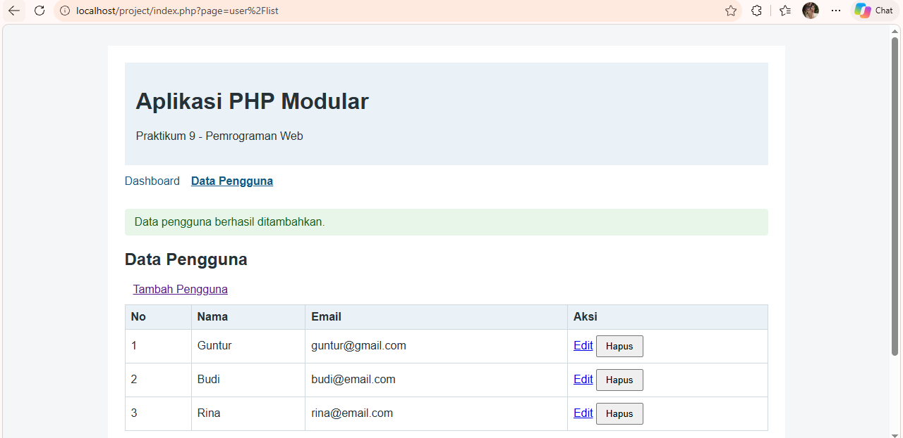
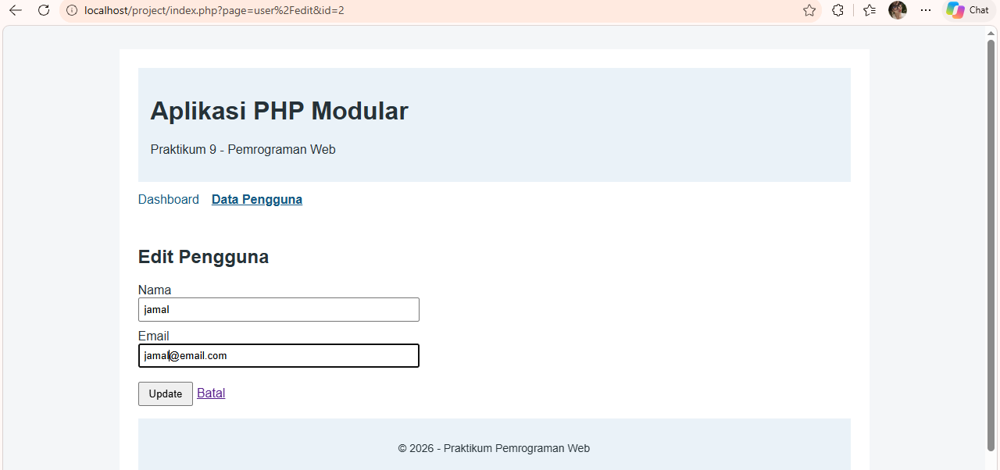
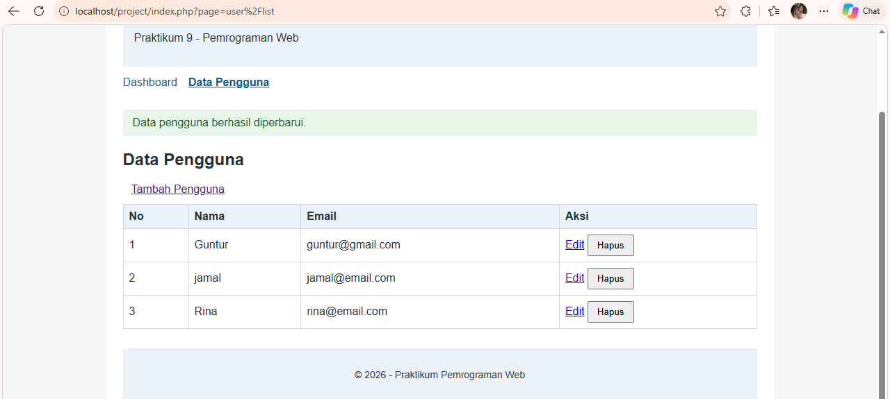
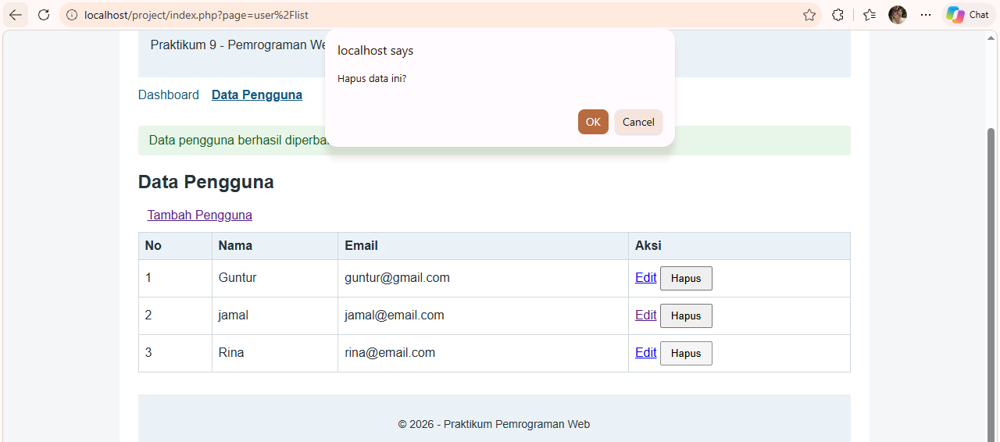
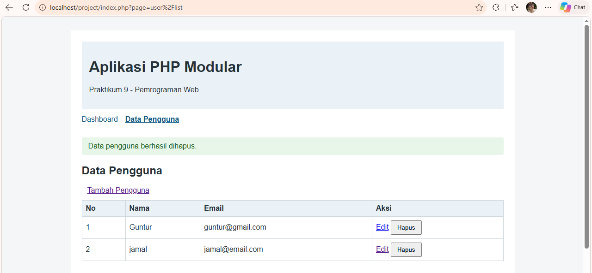

---

## Kendala dan Cara Mengatasinya
* **Perbedaan perilaku saat file tidak ditemukan**: Saat menguji file yang tidak ada, `include` hanya memunculkan *warning* dan melanjutkan baris berikutnya, sedangkan `require` memicu *fatal error* dan menghentikan skrip. Pemilihan konstruksi disesuaikan dengan kebutuhan: `require_once` untuk file wajib/inti agar tidak dimuat berulang, dan `include` untuk komponen non-kritis.
* **Konsistensi tampilan antarhalaman**: Memindahkan elemen berulang ke `header.php` dan `footer.php` memastikan perubahan navigasi atau *layout* cukup dilakukan di satu tempat tanpa menyalin ulang kode ke setiap file halaman.
* **Keamanan *routing* parameter URL**: Menghindari menyusun path file langsung dari `$_GET['page']` dengan menerapkan daftar *whitelist* (`$routes`) dan mengembalikan halaman `404` jika rute tidak terdaftar.